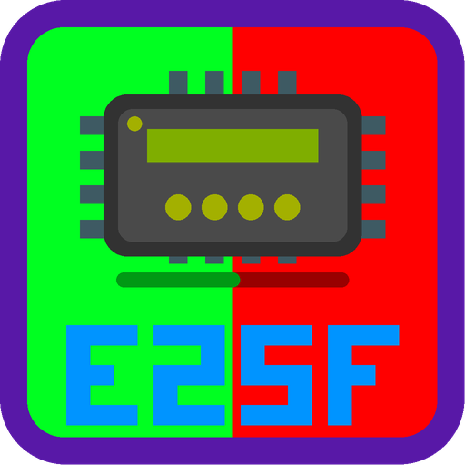
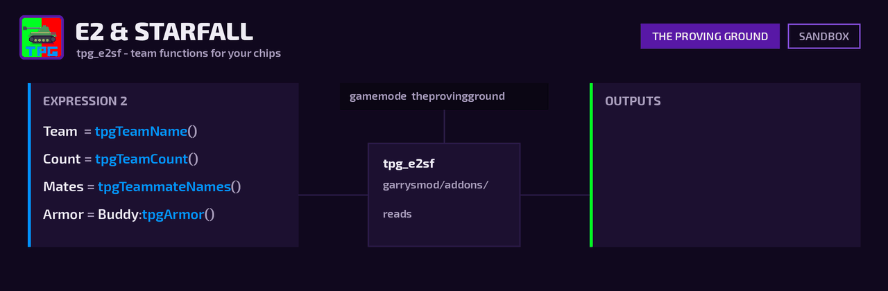

# TPG E2 & Starfall team functions

Expression 2 and Starfall functions for [The Proving Ground](https://github.com/ACE-Project-Team/theprovingground):
who is on your team, where they are, and what they are carrying. On the
[Workshop](https://steamcommunity.com/sharedfiles/filedetails/?id=3820591473).

**Everything is scoped to the chip owner's own team.** Enemy names, positions and loadouts are
never exposed; a chip owned by a spectator or an unassigned player gets empty results.



Install it like any other addon. It needs [Wire](https://github.com/wiremod/wire) for the E2
functions and/or [Starfall](https://github.com/thegrb93/StarfallEx) for the Starfall library;
whichever is missing is simply skipped.

## Expression 2

| Function | Returns |
|----------|---------|
| `tpgTeamCount()` | number of players on your team |
| `tpgTeamName()` | your team's name, `""` if you aren't on one |
| `tpgTeammates()` | array of teammate entities |
| `tpgTeammateNames()` | array of teammate names |
| `E:tpgIsTeammate()` | `1` if `E` is on your team, else `0` |
| `E:tpgArmor()` | teammate's armour tier name |
| `E:tpgPrimary()` / `E:tpgSecondary()` / `E:tpgSpecial()` | teammate's loadout pick |

The per-player getters return `""` for anyone who isn't your teammate.

## Starfall (`tpg` library, server)

| Function | Returns |
|----------|---------|
| `tpg.getTeamCount()` | number of players on your team |
| `tpg.getTeamName()` | your team's name, `""` if you aren't on one |
| `tpg.getTeammates()` | array of teammate entities |
| `tpg.getRoster()` | array of `{ player, name, pos, primary, secondary, special, armor }` |
| `ent:tpgGetLoadout()` | `{ primary, secondary, special, armor }`, `{}` for non-teammates |
| `ent:tpgIsTeammate()` | `true` if `ent` is on your team |

## Building chips in sandbox

Outside TPG there are no teams, so every function returns nothing. To have something to wire
up, the addon sets up two stand-in teams when TPG isn't running:

```
tpg_test_team green
tpg_test_team red
tpg_test_team none
```

Loadouts and armour come from TPG, so in sandbox they read as `""` and `"Unknown"`. When the
gamemode is running the stand-in does nothing and the real teams are used.

## What this reads from TPG

The team ids `TEAM_GREEN` / `TEAM_RED`, `TPG.GetTeamData(team).name`, `TPG.Armor[id].name`, and
the player PData keys `TPG_Armor`, `TPG_Primary`, `TPG_Secondary` and `TPG_Special`. Every read
falls back quietly, so a rename on the TPG side would not error. TPG's
`tests/test_e2sf_contract.lua` pins all of them; change both sides together.

## License

MIT, see [LICENSE](LICENSE).
